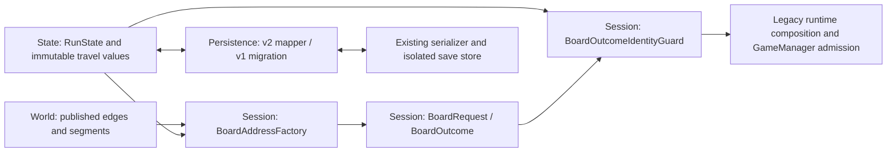

# M3.11 Route Legs and Board Addresses

**Status:** PASS / Done, 2026-10-14.

All thirty-two children are accepted as the state, identity, and stable-boundary persistence foundation. This is not acceptance of production multi-board travel. The owner explicitly assigned Lead, Developer, and Reviewer to the same assistant and permitted one combined task. Final review was self-review, not an independent review; no subagents were used.

Sources of truth: [M3.11 and child cards](../TechnicalRoadmap.md#m311---route-leg-state-and-stable-board-address-tracking-umbrella), [accepted section 27.2](../GameDesignContract.md#272-route-legs-local-boards-and-days), and [repository rules](../../AGENTS.md).

## Baseline and Scope

| Item | Evidence |
| --- | --- |
| Unity workspace | `D:/Repos/HallowBlaze/HallowBlaze` |
| Real Git root | `D:/Repos/HallowBlaze` |
| Clean starting branch | `M3/9.R3-day-transition-intent-ui`, one commit ahead of origin |
| Starting and acceptance HEAD | `0249975b188eaa8e0fece89e90fcfe15ef5bf913` |
| Unity / test framework | `6000.3.21f1` / Unity Test Framework `1.6.0` |
| Automation | Unity CLI `1.0.0-beta.6`; Pipeline `0.5.0-exp.1` |
| Initial connection discovery | `unity pipeline list`, then `unity command`: no reachable live server for this project |
| Executed tests | Supported batchmode `unity test` against the exact workspace; no legacy Unity MCP |

The combined write scope is the union of the child source/test paths, prototype world JSON, this report, and roadmap status/queue updates. Ten new C# sources have Unity-generated matching metadata; existing asset GUIDs are unchanged. No scenes, prefabs, assembly references, package configuration, Unity version, or agent configuration were changed.

The owner separately approved one M1 expected run-schema assertion changing from 1 to 2 and two pre-existing lifecycle assertions changing from `Day: 0` to the already implemented `Day: 1`. The v0 storage fixture now uses explicit historical v0 JSON instead of replacing a schema number in current output. No Day UI implementation was changed. The owner's standing exception ignores the isolated Unity-driven appearance/disappearance of `SENTIS_ANALYTICS_ENABLED`; no other settings drift is included.

No commits, branches, staging, push, profile reset, player-save cleanup, or destructive restoration were performed.

## Ownership



Arrows describe data use, not new assembly references. State stores stable values only: no World, Session, profile owner, Unity object, `Transform`, or `InstanceID`. Session translates published World values into State-owned `RouteSegmentState` copies. Persistence reconstructs State through its validated restore API; it does not reference the world catalogue. Runtime board state and views are reconstructed, not saved here.

| Owner / field | Contract |
| --- | --- |
| World segment | Exact stable `SegmentId`, `GenerationConfigurationId`, positive `GenerationVersion`; immutable |
| World edge | Detached, ordered, nonempty, locally unique segments; `SegmentCount` derives from the list |
| World catalogue | Globally unique segment IDs and unambiguous segment/edge lookup; ordinal keys |
| Run checkpoint | `ReachedCheckpointNodeId` is the last reached node, never the active destination |
| Run day | `CompletedDayCount >= 0`; active `DayNumber = CompletedDayCount + 1`; first leg is Day 1 |
| Run allocator | Persisted `TraversalSequence`; deterministic `leg.1`, `leg.2`, ...; checked overflow and no ID reuse |
| Run history | One ordered immutable-entry authority; legacy `Route` is a derived, detached node-only compatibility view |
| Active leg | Leg/edge/from/to/day, detached ordered segment/configuration values, cursor/count, intro state |
| Active progress | Zero-based `SegmentIndex = CompletedSegmentCount`, both inside the segment list |
| Intro | `Pending` only at cursor 0; `Consumed` permits progress; no `Presented` state |
| Completed entry | Exact leg/edge/from/to/day and `CompletedSegmentCount = SegmentCount` |
| Legacy entry | Reached `ToNodeId` only; leg, edge, source, day, and segment evidence remain absent |
| Board address | Run/leg/edge/segment/day/configuration/version/seed; every field participates in equality |
| Profile | Existing atlas/knowledge/schema ownership unchanged; no travel operation owns or clears it |

Restore validates IDs, day/count/cursor/intro, ordered completed traversals, checkpoint/history continuity, and allocator consistency before replacing any state. Terminal status and existing health, Food, and tool-slot validation are preserved. Run reset clears run-owned travel, never profile knowledge.

## Transition Contract

For a fresh checkpoint `a`, zero completed days, and edge `a -> b` with two segments:

| Operation | Active state | Completed days / reached checkpoint / completed history |
| --- | --- | --- |
| `StartLeg` | `leg.1`, Day 1, segment 1, index/count 0, Pending | `0 / a / unchanged` |
| `TryConsumeIntro(leg.1)` | Same identity/progress, Consumed | Unchanged |
| Repeat consume / wrong leg | False; no change | Unchanged |
| Complete segment 1 | Segment 2, index/count 1, same Day 1 and Consumed | Unchanged |
| Repeat segment 1 / wrong segment | False; no change | Unchanged |
| Complete final segment 2 | Active leg cleared | `1 / b / one completed leg.1 entry` |
| Repeat final completion | False; no change | Unchanged |
| Next legal departure | `leg.2`, Day 2, Pending | Prior checkpoint/history retained |

Intermediate and final transitions require the active status, matching leg and stable current segment, and Consumed intro. Start validates source, absence of an active leg, status, IDs, segments, day, and allocator overflow before mutation. Tests also cover five segments, parallel roads, repeated traversal, terminal state, and independently owned copies. Travel transitions do not consume resources, discover nodes/edges, save files, or render anything.

`TryConsumeIntro` changes pure state only. M3.12 must durably checkpoint Consumed **before** rendering; across a crash the intro can be skipped, never repeated. A consumed in-memory value alone is not evidence of durable rendering order.

## Published Segment Registry

[Prototype world](../../Assets/GameData/World/prototype-world.json) remains `world-1`, version `1`, with the same eight nodes, nine directed edges, topology, endpoints, directions, and clues. Existing profile/world binding and node/edge discovery IDs are unchanged.

Each row below defines exactly five ordered IDs by appending `.entry`, `.stretch`, `.clearing`, `.approach`, `.arrival` to its segment prefix. All 45 segments use `legacy.board.v1`, generation version `1`.

| Edge ID | Exact segment prefix |
| --- | --- |
| `road.start-west-trail` | `segment.start-west-trail` |
| `road.start-east-creek` | `segment.start-east-creek` |
| `road.west-trail-old-road` | `segment.west-trail-old-road` |
| `road.east-creek-old-road` | `segment.east-creek-old-road` |
| `road.old-road-west-grove` | `segment.old-road-west-grove` |
| `road.old-road-east-quarry` | `segment.old-road-east-quarry` |
| `road.west-grove-ridge` | `segment.west-grove-ridge` |
| `road.east-quarry-ridge` | `segment.east-quarry-ridge` |
| `road.ridge-radio-tower` | `segment.ridge-radio-tower` |

Five is authored content, not a model invariant. One-, two-, and five-segment cases are supported. Explicit null/empty/malformed lists, duplicate IDs, coerced scalar types, case aliases, and duplicate/unknown JSON properties fail rather than producing a partial catalogue.

The temporary five-argument edge constructor and JSON with an absent `segments` field use exactly one segment: `legacy.segment:{edgeId}`, configuration `legacy.board.v1`, version `1`. Absence alone selects compatibility; explicit invalid data does not. The published prototype no longer uses this adapter. Its singleton IDs are not aliases for the new published registry.

## Address and Seed

`BoardAddressFactory.Create(run, world)` checks edge/endpoints/nodes and every segment/configuration/version association before deriving the current address. `CreateFromState(run)` reconstructs a run-owned identity for runtime admission; it deliberately does not claim catalogue validation. Legacy checkpoint seed derivation is unchanged; `GetBoardSeed()` rejects active-leg use.

The seed algorithm is frozen as FNV-1a32: offset `2166136261`, prime `16777619`, unchecked 32-bit multiply/XOR, returned as signed `int`. Strings are UTF-8 with a 32-bit little-endian byte-length prefix; integers are signed 32-bit little-endian. Field order:

```text
"hallowblaze.route-board.v1"
runId
rootRunSeed
legId
edgeId
stableSegmentId
dayNumber
generationConfigurationId
generationVersion
```

For run `run.test`, root seed `1729`, edge `edge`, the fixed vectors are:

| Leg / segment / day | Configuration / version | Board seed |
| --- | --- | ---: |
| `leg.1 / segment.1 / 1` | `legacy.board.v1 / 1` | `-111777454` |
| `leg.1 / segment.2 / 1` | `legacy.board.v1 / 1` | `1058255485` |
| `leg.3 / segment.1 / 3` | `legacy.board.v1 / 1` | `1887943502` |
| `leg.1 / segment.1 / 1` | `alternate.board.v2 / 2` | `1768038604` |

These were checked with an independent PowerShell byte-stream calculation as well as Unity assertions. Cursor ordinal, catalogue enumeration, Unity identity, clocks, and cosmetic randomness are excluded. Reordering catalogue inputs or moving an unchanged segment definition within an edge does not change that segment's seed for the same explicit identity inputs. Route order still controls which segment is current. A 32-bit seed is not collision-free; full structural address equality, not seed equality or dictionary hash, is authoritative.

## Admission Matrix

| Input change | Expected admission / evidence |
| --- | --- |
| Run ID | Reject before transition, save, lifecycle, or scene effects |
| Leg ID | Reject even when node/day/seed metadata match |
| Edge ID | Reject parallel/foreign road |
| Stable segment ID | Reject wrong segment and old cursor |
| Displayed day | Reject wrong day |
| Generation configuration | Reject wrong configuration |
| Generation version | Reject wrong generation context |
| Board seed | Reject altered seed |
| Addressed vs legacy request | Never equal, even with matching legacy tuple |
| Changed current run after request creation | Reject stale request/outcome |
| Duplicate progress/final completion | Rejected by current identity/transition; no second advancement |
| Matching current addressed request | Pure guard accepts; runtime composes |
| Matching addressed production outcome | Not applied yet: GameManager returns false until M3.12 owns travel orchestration |
| Matching checkpoint-only request/outcome | Existing production flow remains supported |

Requests retain the exact address, and outcomes expose their original request/address. Composer validation runs before publishing a runtime. GameManager calls the guard before outcome/lifecycle/save effects and keeps its existing single-outcome/single-coordinator ownership. The production PlayMode matrix sends both exit and death for all eight altered fields, checks unchanged run/profile and save bytes, and observes zero coordinator resolutions. EditMode additionally covers saved-byte preservation, a valid one-time pure transition, and stale callbacks after intermediate/final progress.

## Persistence and Compatibility

| Input / field | Accepted result |
| --- | --- |
| Normal write | Explicit independent run v2 document |
| Supported v1 read | Validate v1, migrate in memory, restore a v2-compatible checkpoint |
| Supported v2 read | Strictly validate tokens, fields, and State invariants before publication |
| v1 `currentDay` | v2 `completedDayCount`, including zero/max; next departure checks overflow |
| v1 `worldNodeId` | `reachedCheckpointNodeId` |
| v1 ordered `route` nodes | Ordered `legacyCheckpoint` entries; repeated nodes preserved |
| v1 unknown leg/edge/source/day/segments | Explicit null evidence, no fabricated traversal; `activeLeg = null`, sequence `0` |
| Run ID / root seed / health / Food / tools / status | Preserved, including active/dead/won and maximum-value cases |
| v2 history / active leg / allocator | Persisted once as authoritative values; address recomputed, not cached |
| Profile schema/data | Existing profile v2 unchanged; no run migration writes or resets it |
| Unknown future version | Existing controlled unsupported-version handling; no rewrite |
| Corrupt current run with valid backup | Existing validated backup recovery |
| Unrecoverable run | Controlled failure; valid profile bytes/knowledge remain usable and unchanged |

The historical `RunStateDto.CurrentSchemaVersion` remains `1`; it was not relabeled. `RunStateV2Dto` is a separate opt-in family. `SerializeTravelRun` / `DeserializeTravelRun` were verified before normal `SerializeRun` / `DeserializeRun` forwarded to them. The pre-activation integrated codec gate passed `41/41`; activation was then followed by DTO/storage regression and the final complete gate.

V2 requires every declared field, with explicit allowed nulls for `activeLeg` and absent legacy evidence. No duplicate legacy `route`, mutable address cache, board layout, view/animation, or mid-board snapshot is serialized. New v2 scalar checks prevent Newtonsoft coercing numeric IDs, string integers, or fractional integers. Exact-case property binding prevents `RunId`/`SegmentId` aliases from bypassing type checks. Duplicate keys, trailing documents, unknown fields/tags, `presented`, contradictory cursor/day/sequence, and fabricated legacy evidence are controlled failures.

Isolated storage cases cover checkpoint, Pending, Consumed, and intermediate state, reconstruct the same address, load a good backup, then reject both-corrupt files while preserving exact profile bytes. Loading v1 does not rewrite its source; the next deliberate save writes v2 and retains the original v1 as backup. Existing v0 store migration/future-version protection still passes. Tests use external temporary roots, never the real player profile directory.

### JSON Examples

This complete synthetic checkpoint document uses the same values as the shared persistence fixture:

```json
{
  "schemaVersion": 2,
  "runId": "run.test",
  "runSeed": 1729,
  "completedDayCount": 0,
  "reachedCheckpointNodeId": "a",
  "traversalSequence": 0,
  "health": 100,
  "food": 100,
  "status": "active",
  "toolSlots": [
    { "toolId": "axe", "remainingUses": 3 },
    { "toolId": "", "remainingUses": 0 }
  ],
  "travelHistory": [
    {
      "kind": "legacyCheckpoint",
      "toNodeId": "a",
      "legId": null,
      "edgeId": null,
      "fromNodeId": null,
      "dayNumber": null,
      "segmentCount": null,
      "completedSegmentCount": null
    }
  ],
  "activeLeg": null
}
```

For the Pending example, retain that document's checkpoint/resources/history, set `traversalSequence` to `1`, and replace `activeLeg` with:

```json
{
  "legId": "leg.1",
  "edgeId": "edge",
  "fromNodeId": "a",
  "toNodeId": "b",
  "dayNumber": 1,
  "segmentIndex": 0,
  "completedSegmentCount": 0,
  "introState": "pending",
  "segments": [
    { "segmentId": "segment.1", "generationConfigurationId": "legacy.board.v1", "generationVersion": 1 },
    { "segmentId": "segment.2", "generationConfigurationId": "legacy.board.v1", "generationVersion": 1 }
  ]
}
```

The Consumed example is the same complete Pending document with only `introState` changed to `"consumed"`. This does not move the cursor or checkpoint. An intermediate example additionally sets both `segmentIndex` and `completedSegmentCount` to `1`; it still has Day 1, zero completed days, reached checkpoint `a`, and the same `leg.1`. The explicit writer/reader and shared fixture exercise these exact boundaries rather than inferring active state from missing fields.

## Scenario Evidence

`TravelSequence_PreservesExplicitBoundaryState` exercises two- and five-segment departure/intro/progress/final sequences with unchanged resources/tools and independent owners. `SavedTravel_ContinuesFromExplicitBoundary` covers five stable boundaries: checkpoint, Pending, Consumed, intermediate, completed. It uses actual isolated disk persistence, compares every field/address against an independently prepared equivalent run, and performs the next permitted operation exactly once.

`AddressedTravel_PreservesExplicitTurnOutcomesAfterLoad` has twelve cases: Pending, Consumed, intermediate, parallel edge, repeated traversal, and v1 legacy checkpoint, each with normal/reversed unordered catalogue/enemy input. Every case restores its own run and creates fresh board/enemy/controller owners. A wall is at `(0,1)`, player at `(1,1)`, enemies 2/3 at `(3,1)` / `(3,2)`, damage 20/10:

| Command | Explicit expected result |
| --- | --- |
| Wait | Food 99; enemies move to `(2,1)` / `(2,2)` and enter Rest |
| West into wall | Rejected; Food/Health/positions/retained plans/cadence unchanged |
| Wait | Food 98; Rest resolves, next fixed/conditional attacks are planned |
| North to `(1,2)` | Food 97; enemy 2 misses its locked old cell, enemy 3 hits its conditional cell for 10; Health 90; neither moves; both enter Rest |

Typed event order, retained intents, resources, positions, cadence, history, address/seed, rejection behavior, and source/restored-owner independence are asserted. This is concrete local-turn regression, not portable replay or a canonical snapshot/hash protocol.

## Child Acceptance

Every named check below executed successfully in the final gate. Names are qualified by fixture; all are in `HallowBlaze.Tests.EditMode` except the explicitly marked PlayMode check. Parameterized counts belong to their fixtures and are not separate handoff reports.

| Child | Owning executable evidence |
| --- | --- |
| M3.11.1 | `WorldDefinitionTests.RouteSegment_ValidatesStableGenerationIdentity` |
| M3.11.2 | `WorldDefinitionTests.EdgeSegments_AreOrderedDetachedAndNonempty` |
| M3.11.3 | `WorldDefinitionTests.Catalogue_RejectsGlobalSegmentAliases` |
| M3.11.4 | `WorldDefinitionTests.WorldJson_ReadsExplicitSegmentsAndRejectsMalformedRows`; scalar/case-alias regression |
| M3.11.5 | `WorldDefinitionTests.PrototypeWorld_HasFrozenExplicitSegmentRegistry`; original topology/binding checks |
| M3.11.6 | `RouteLegTests.TravelEntry_DistinguishesParallelEdgesAndLegacyEvidence` |
| M3.11.7 | `RouteLegTests.ActiveLeg_ValidatesDetachedProgressAndIntroState` |
| M3.11.8 | `RunStateTests.CheckpointTravelState_HasOneHistoryOwnerAndSafeReset` |
| M3.11.9 | `RouteLegTests.StartLeg_CreatesPendingIdentityWithoutArrival` |
| M3.11.10 | `RouteLegTests.IntroConsumption_IsIdentityGuardedAndIdempotent` |
| M3.11.11 | `RouteLegTests.IntermediateSegment_AdvancesOnceWithoutDayOrArrival` (2/5 segments) |
| M3.11.12 | `RouteLegTests.FinalSegment_CommitsOneStructuredArrival` |
| M3.11.13 | `RouteLegTests.BoardAddress_UsesEveryStableIdentityField` |
| M3.11.14 | `RouteLegTests.BoardSeed_HasStableSegmentIdentityVectors` |
| M3.11.15 | `RouteLegTests.BoardRequestAndOutcome_PreserveFullAddressIdentity` |
| M3.11.16 | `RouteLegTests.OutcomeGuard_RejectsForeignAddressBeforeMutation` |
| M3.11.17 | `BoardRuntimeCompositionTests.AddressedComposition_RejectsStaleIdentityWithoutPartialRuntime` |
| M3.11.18 | PlayMode `BoardRuntimeStartupTests.ForeignBoardAddress_CannotReachProductionOutcomeEffects` |
| M3.11.19 | `PersistenceDtoTests.RunV2Dto_HasExplicitTravelSchemaWithoutV1Cutover` |
| M3.11.20 | `PersistenceDtoTests.RunV2Mapper_RoundTripsAllStableTravelBoundaries` |
| M3.11.21 | `PersistenceDtoTests.RunV1Migration_PreservesCheckpointWithoutInventedTravel` |
| M3.11.22 | `PersistenceDtoTests.TravelRunReader_DispatchesSupportedSchemasOrRejects`; strict scalar/case binding |
| M3.11.23 | `PersistenceDtoTests.TravelRunWriter_EmitsCompleteV2StableState` |
| M3.11.24 | `PersistenceDtoTests.TravelPersistence_RoundTripsMigratesAndRejectsCorruption`; pre-activation `41/41` |
| M3.11.25 | `PersistenceDtoTests.DefaultRunSchema_UsesAcceptedV2WithoutProfileChange` |
| M3.11.26 | `PersistenceStorageTests.TravelRunRecovery_PreservesProfileAndStableBoundary` (4 cases) |
| M3.11.27 | `RouteLegTests.TravelSequence_PreservesExplicitBoundaryState` (2 cases) |
| M3.11.28 | `RouteLegTests.AddressedContexts_PreserveExplicitIdentityAndSeed` |
| M3.11.29 | `RouteLegTests.SavedTravel_ContinuesFromExplicitBoundary` (5 cases) |
| M3.11.30 | `RouteLegTests.ForeignOrStaleOutcome_PreservesCurrentTravel` |
| M3.11.31 | `RouteLegTests.AddressedTravel_PreservesExplicitTurnOutcomesAfterLoad` (12 cases) |
| M3.11.32 | Fresh full EditMode, production-focused PlayMode, scope/metadata audit, and owner-authorized final self-review |

## Final Validation

These exact commands ran against the final code candidate after all review corrections. XML/logs remain external temporary artifacts, not source files:

```powershell
unity test "D:\Repos\HallowBlaze\HallowBlaze" --mode EditMode --output "$env:TEMP\HB-M311-acceptance-editmode-0249975b.xml" --timeout 480 -- -nographics -logFile "$env:TEMP\HB-M311-acceptance-editmode-0249975b.log"

unity test "D:\Repos\HallowBlaze\HallowBlaze" --mode PlayMode --filter "HallowBlaze.Tests.PlayMode.BoardRuntimeStartupTests;HallowBlaze.Tests.PlayMode.GameSessionLifecycleTests;HallowBlaze.Tests.PlayMode.PlayModeInfrastructureTests" --output "$env:TEMP\HB-M311-acceptance-playmode-0249975b.xml" --timeout 480 -- -nographics -logFile "$env:TEMP\HB-M311-acceptance-playmode-0249975b.log"
```

| Gate / XML UTC execution | Total / passed | Failed / skipped / inconclusive |
| --- | --- | --- |
| Full EditMode, 2026-10-14 07:59:38-07:59:42Z | `635 / 635` | `0 / 0 / 0` |
| Production PlayMode, 2026-10-14 08:00:16-08:00:26Z | `39 / 39` | `0 / 0 / 0` |

Final EditMode includes WorldDefinition 16, RunState 24, RouteLeg 32, BoardRuntimeComposition 17, PersistenceDto 50, and PersistenceStorage 19 cases, plus the rest of the existing suite. Final PlayMode contains BoardRuntimeStartup 9, GameSessionLifecycle 18, and PlayModeInfrastructure 12 cases. Fresh XML identity, nonzero execution counts, Passed status, and zero failures/skips/inconclusive were inspected; Unity compilation succeeded. Relevant editor diagnostics are empty. `git diff --check` passed; Unity's line-ending warnings are not behavioral changes.

The final source candidate's 37 changed/new asset paths were SHA-256 recorded before documentation closeout. The ten new source/meta pairs were checked for valid, distinct Unity-generated GUIDs. Branch/HEAD, no staging, closed path scope, unchanged existing metadata, and source fingerprints are checked again at closeout. Documentation checks verify all thirty-two child statuses/evidence, local links, examples/registry, and M3.12 remaining Planned. Documentation does not require a further Unity run.

## Review Verdict and Limits

Final self-review: PASS, no remaining identified blocking defect in the scoped foundation. Review traced State ownership, restore-before-mutation, full identity rather than seed-only checks, production guard ordering, compatibility adapters, schema activation/migration, isolated recovery, and public XML contracts.

Review found two real JSON defects and fixed them before the final gate: Newtonsoft scalar coercion initially accepted ten malformed cases; exact token validation made that regression pass. Case-insensitive DTO binding then exposed an alias bypass; exact-case field validation and three additional cases closed it. Earlier full-suite failures were the separately approved stale schema/Day test assertions, not new profile or Day-rendering behavior. Tests were not disabled or filtered away to obtain the final pass.

This is not independent review, measured player testing, a manual graphical smoke test, generator determinism certification, a mid-board save, or a completed multi-board playthrough. No such evidence is claimed. The relevant MonoBehaviour/lifecycle boundary is covered by the 39 production-focused PlayMode cases; no scene/UI presentation was changed.

## M3.12 Readiness

M3.12 remains Planned; its existing card still says `Presented` and checkpoints after showing the intro. Before making it Ready, align that planning with accepted section 27.2: Pending/Consumed, durable Consumed checkpoint **before rendering**, and explicit at-most-once crash behavior. This report does not rewrite or implement that follow-up.

M3.12 must provide the focused travel/session owner that starts a leg from a route choice, saves the start, consumes/checkpoints the intro before rendering with HUD/input gating, composes the exact current addressed segment, and handles matching outcomes. It must advance/save intermediate boundaries without day/discovery/atlas changes; only final arrival commits run completion plus the appropriate profile discovery and route choice. It must specify death/Continue/crash behavior and preserve the same address on board restart. Matched active-leg outcomes must not remain silently blocked once that orchestration is activated.

Use the accepted State transitions, address factory, guard, and v2 stable-boundary schema rather than adding another travel ledger or resolver. Cover two-/five-segment production flows, duplicates, intermediate death, Pending/Consumed recovery, final discovery, hidden-HUD Day transition, and failed durable checkpoints. Observation accumulation and future inventory/replay remain in their own tickets. M4 follows this production cutover, not this foundation alone.